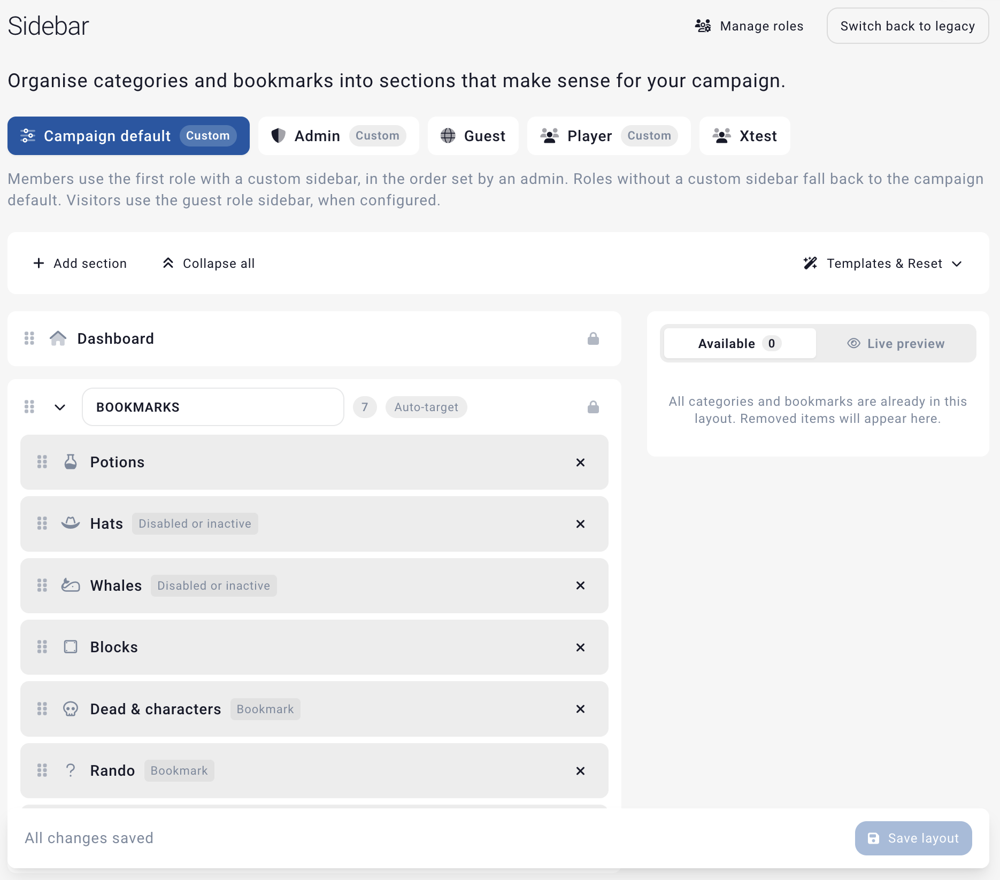

# Sidebar

The campaign sidebar is the main navigation menu for your world. Every campaign uses Kanka's sidebar layout with sections for **Bookmarks**, **World**, **Time**, **Game**, and **Other**, along with core navigation links (**Dashboard**, **Relations**, **Gallery**, **Recent**, and **Settings**).

For **premium campaigns**, Admins can fully customise the sidebar layout, create custom sections, arrange categories and bookmarks together, and even build different sidebars for different roles.

.. note::
   Customising the sidebar requires a **premium campaign** and **Admin** permissions. Non-premium campaigns automatically use Kanka's standard sidebar layout.

## Accessing Sidebar Setup

1. Open your campaign and go to **Settings** in the sidebar.
2. Under **Customisation**, click **Sidebar**.

## Organising Your Sidebar

The sidebar editor is split into two areas: the **layout builder** on the left and a panel with the **Available** tray and **Live preview** on the right.

### Managing Sections

* **Add a section:** Click **Add section** in the toolbar. A new section is added at the bottom of the layout and focused so you can name it immediately (up to 90 characters; section names cannot be empty).
* **Rename a section:** Click any section header name to edit it inline.
* **Collapse or expand sections:** Click the chevron next to a section to fold it while editing, or use **Collapse all** / **Expand all** in the toolbar.
* **Hide all items in a section:** Click the eye-slash icon on a section header to move all removable items in that section to the **Available** tray at once (protected system items stay in place). An **Undo** banner appears if you want to revert.
* **Remove a section:** Click the **×** button on a custom section to remove it. Removing a section does **not** delete or hide its items—they remain in place at the top level, and an **Undo** banner lets you restore the section before saving.

.. tip::
   Empty sections—or sections whose items are all hidden or inaccessible to the viewer—are automatically hidden in the live sidebar.

### Arranging Categories, Bookmarks, and System Links

In Sidebar v2, **standard categories**, **custom categories**, **bookmarks**, and **system navigation links** all live in the same layout editor:

* **Drag and drop:** Grab the grip handle on any item or section to reorder it or move it into another section (you can also place items at the top level outside any section).
* **Buttons & dropdown (desktop and mobile friendly):** Every row has **Move up** / **Move down** buttons, and non-section items include a **Move to…** dropdown to jump straight to **Top level** or any section.
* **Hiding items:** Click **×** on any category or bookmark to remove it from the sidebar. This only removes its placement in the sidebar—it never disables or deletes the category or bookmark.
* **Re-adding hidden items:** Removed items appear in the **Available** tab on the right (grouped under **Categories** and **Bookmarks**, with a filter box when more than 5 items are available). Drag an item back into any section, or click **+** to quick-add it to **Bookmarks**.

### Protected Items & the Bookmarks Section

Some items are locked (marked with a lock icon) so your campaign always remains navigable:

* **System navigation items** (**Dashboard**, **Relations**, **Gallery**, **Recent**, and **Settings**) can be moved to any position or section, but cannot be removed from the sidebar.
* **The Bookmarks section** (**Auto-target**) can be renamed and moved, but cannot be removed. Whenever a **new category or bookmark** is created in your campaign, Kanka automatically appends it to the end of the **Bookmarks** section in every layout so nothing goes missing.

### Renaming Items and Changing Icons

Sidebar Setup focuses on structure and organisation:

* **Section headers** are renamed directly inside the Sidebar editor.
* **Category names and icons** are managed in **Settings > Categories**, so your custom names and icons stay consistent everywhere in the campaign (not just in the sidebar).
* **Bookmark names and icons** are managed in **Bookmarks**.

## Role-Specific Sidebars

Premium campaigns can configure a **Campaign default** sidebar as well as tailored sidebars for individual campaign roles—including **Admins**, player roles, and **Public visitors**.

### How Role Inheritance and Priority Work

* Use the role tabs at the top of the Sidebar page to switch between **Campaign default** and any campaign role.
* Roles without a custom layout inherit the **Campaign default**. Saving changes while viewing an inheriting role creates a custom sidebar for that role (indicated by a **Custom** badge on its tab).
* **Multiple roles:** If a member belongs to more than one role, they see the **first** role that has a custom sidebar, following the role order configured by an admin (click **Manage roles** to adjust role order). If none of their roles have a custom sidebar, they fall back to the **Campaign default**.
* **Public visitors:** Visitors who are not campaign members see the public/guest role's sidebar when configured, or the **Campaign default** otherwise.

### Permissions and Visibility Indicators

Sidebar layouts never override campaign permissions. If a user does not have permission to view a category, bookmark, or system page, it will not appear in their sidebar.

To help you design role-specific layouts, the editor highlights items that won't be visible:

* **Disabled or inactive badge:** The category is disabled in **Settings > Categories**, or the bookmark is inactive / Bookmarks are disabled.
* **Warning eye-slash icon:** The selected role cannot see the item due to role permissions, because the bookmark is private (admins only), or because it is admin-only navigation (**Relations** / **Recent**). Hover over the icon for details.

## Live Preview, Templates, and Resetting

### Live Preview

Switch the right-hand panel from **Available** to **Live preview** to see how your sidebar will look as you edit. When editing a role, you can toggle **Hide items inaccessible to <Role>** to preview the exact sidebar that role will see (including automatic hiding of empty sections).

### Templates & Reset

Open the **Templates & Reset** menu in the toolbar to quickly populate or reset the current layout:

* **Copy campaign default** *(role tabs only)*: Loads the Campaign default layout into the editor as a starting point.
* **Copy from <Role>**: Copies the saved layout from any other role that already has a custom sidebar.
* **Start from standard layout**: Loads Kanka's default sidebar layout into the editor (can be undone before saving).
* **Reset to standard sidebar** *(Campaign default)* / **Use campaign default** *(role tabs)*: Immediately removes the saved custom layout for the current tab. Resetting the Campaign default does not affect custom role layouts, and resetting never deletes categories or bookmarks.

### Saving Changes

* Click **Save layout** in the bottom bar to publish your changes immediately, or **Discard changes** to revert unsaved edits.
* If another admin saves changes to the sidebar while you are editing, Kanka will warn you to reload the page before saving so you don't accidentally overwrite their updates.
* Sidebar v2 layouts are included when exporting and importing campaigns.

## Migrating from Sidebar v1 (Legacy) to Sidebar v2

All **new campaigns** and **non-premium campaigns** already use Sidebar v2 automatically. Existing **premium campaigns** that were using the legacy v1 sidebar remain on v1 until an Admin chooses to upgrade.

### How to Upgrade

1. Go to **Settings > Customisation > Sidebar**.
2. In the upgrade box at the top of the legacy sidebar page, click **Start anew with sidebar v2**.
   *(If you previously saved v2 layouts, you can also click **Restore saved v2 layouts**.)*
3. Sidebar v2 is immediately enabled with a clean standard layout using your campaign's current category names and icons. Your legacy v1 settings are retained safely in the background.

.. note::
   Switching to Sidebar v2 is designed as a one-way upgrade on live campaigns. Your categories, bookmarks, and entities are never deleted when upgrading or resetting layouts.

### What Changed & Post-Migration Checklist

After upgrading from v1 to v2, review these four things:

1. **Move sidebar-only names and icons to Categories:**
   In v1, you could override a category's label and icon only inside the sidebar. In v2, the sidebar uses each category's native name and icon. If you had custom names or icons in your v1 sidebar, set them in **Settings > Categories** so they apply across your entire campaign.

2. **Clean up duplicate custom-category bookmarks:**
   In v1, custom categories did not appear natively in the sidebar, so admins often created a bookmark pointing to each custom category. In v2, **custom categories appear natively in the sidebar** (initially placed in the **Bookmarks** section so you can move them wherever you like).
   Any legacy bookmark that links directly to a custom category (without custom filters, tabs, or submenus) is automatically flagged with a **Duplicates category** badge and a notice banner at the top of the editor. You can either remove those duplicate bookmarks from your sidebar layout or delete them in **Bookmarks**.

3. **Organise bookmarks directly in the Sidebar editor:**
   In v1, each bookmark's placement was controlled by its individual **Position** setting. In v2, bookmarks are ordered and placed into sections directly in **Settings > Customisation > Sidebar**. New bookmarks you create in the future will automatically appear at the end of the **Bookmarks** section in every layout until an admin moves them.

4. **Set up role-specific layouts (optional):**
   Once you are happy with your **Campaign default** sidebar, switch to a player or **Public visitors** role tab, use **Templates & Reset > Copy campaign default**, and remove any sections or items that role doesn't need.